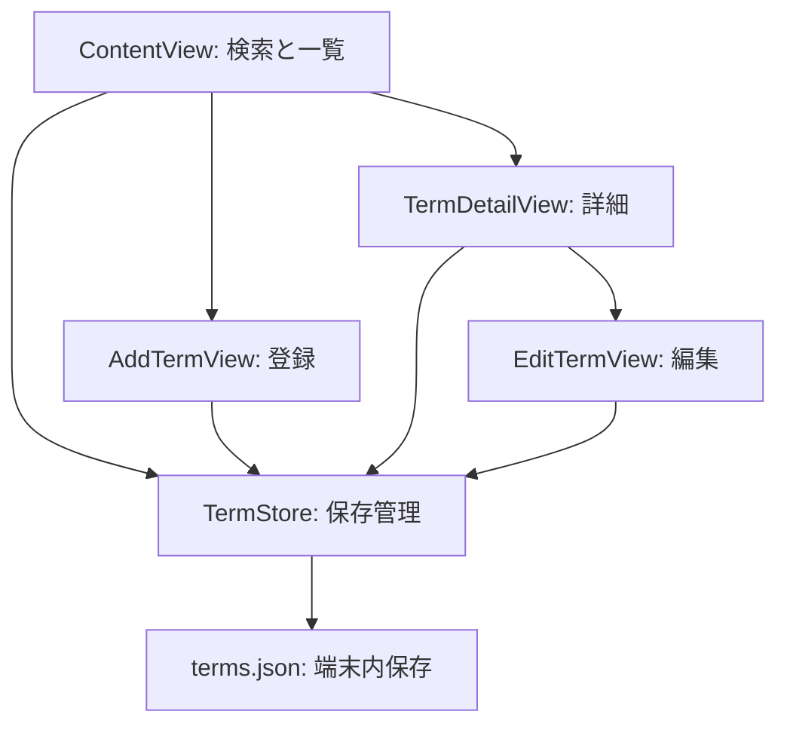

# Myプログラミング辞書アプリ

**調べた用語を自分の言葉で残し、必要なときにすぐ探せる、iPhone向けの個人用辞書アプリです。**

Swift / SwiftUIで制作した個人開発の学習プロジェクトです。C++・C#などのプログラミング用語に加え、「その他」として豆知識も記録できます。アカウント登録やサーバーを使わず、登録内容を端末内のJSONファイルに保存します。

| 項目 | 内容 |
| --- | --- |
| アプリ名 | Myプログラミング辞書アプリ |
| 開発形態 | 個人開発 |
| 制作目的 | プログラミング学習で調べた知識の蓄積・検索・再利用 |
| 開発目標 | 1週間でローカル利用できる初版を作る |
| 使用技術 | Swift / SwiftUI / Foundation / Combine / UIKit |
| データ保存 | Codable・JSONEncoder・JSONDecoderによる端末内ファイル保存 |
| 利用形態 | 自分のiPhoneへXcodeからインストール。App Store未公開 |

## 制作背景

学習中に調べた用語やコード例を、自分が理解しやすい説明と一緒に整理し、あとから探し直せるようにしたいと考えて制作しました。初版では「登録・検索・詳細表示・編集・削除・保存」を中心に実装し、よく参照する用語を見つけやすくするために、お気に入り機能を追加しました。

## 主な機能

| 機能 | 動作 |
| --- | --- |
| 用語の登録 | タイトル・言語・分類・説明・使用例を登録 |
| 入力チェック | タイトル・説明が空欄または空白だけのときは保存不可。使用例は任意 |
| 言語の絞り込み | C++・C#・Swift・Python・その他から選択 |
| タイトル検索 | 部分一致で検索。英字の大文字・小文字を区別しない照合 |
| 表記の絞り込み | タイトルに含まれる英字・漢字／ひらがな・カタカナから判定 |
| 分類の絞り込み | 基本文法・データ型・コレクションなどで絞り込み |
| 結果表示 | ヒット件数・全登録数を表示。0件の場合は案内を表示 |
| お気に入り | 検索結果の右側のピンで登録・解除し、結果の先頭へ表示 |
| 詳細表示 | タイトル・言語・分類・説明・使用例を表示 |
| 編集・削除 | 編集フォームで変更。削除前に確認ダイアログを表示 |
| コードのコピー | 使用例をクリップボードへコピー |
| ローカル保存 | アプリ再起動後も登録内容・お気に入り状態を保持 |

### お気に入りと並び順

1. 言語・キーワード・分類・表記の条件に合う用語を抽出します。
2. お気に入りを先頭へ配置します。
3. お気に入り同士・通常の用語同士は、端末の言語設定に沿った自然なタイトル順で並べます。
4. タイトルの比較結果が同じ場合は、IDで並び順を固定します。

お気に入りでも検索条件に一致しなければ表示しません。青い塗りつぶしピンが登録済み、灰色の輪郭ピンが未登録です。カードのタップとピンのタップを分けているため、詳細画面を開かずに状態を切り替えられます。

### 表記による絞り込み

- **すべて**：表記で制限しません。
- **英語**：タイトルにA〜Zまたはa〜zを含む用語。
- **日本語**：タイトルに漢字またはひらがなを含む用語。
- **カタカナ**：タイトルにカタカナを含む用語。

混在したタイトルは複数の区分に該当します。例えば「配列のソート」は日本語・カタカナの両方に該当します。翻訳・別名検索ではないため、「ソート」を「sort」で検索する機能は現在ありません。

### 分類

基本文法 / データ型・コレクション / 関数・メソッド / クラス・設計 / アルゴリズム / エラー対処 / 豆知識 / その他

「すべての分類」は検索条件の解除に使う項目であり、登録用の分類には含めません。

## 操作の流れ

- **登録**：検索画面右上の「＋」→ 各項目を入力 →「保存」。
- **検索**：言語を選択 → キーワード・表記・分類を指定 → 結果のカードをタップ。
- **お気に入り**：検索結果右側のピンをタップ。再度タップすると解除。
- **編集**：詳細画面の「編集」→ 内容を変更 →「保存」。キャンセル時は元の内容を保持。
- **削除**：詳細画面の「この用語を削除」→ 確認画面で確定。
- **コピー**：使用例の「コピー」をタップ。

## 設計と工夫

### 画面と保存処理の分離

`Term`が用語1件のデータ、`TermStore`が保存・読み込み・更新を担当します。検索画面で生成した`TermStore`を各画面へ渡し、`@Published`による変更をUIに反映します。用語カードは`TermRowView`として切り出しています。

### 保存失敗時に画面とファイルを食い違わせない

追加・編集・削除・お気に入り変更では、変更後の配列を作り、ファイルへの書き込みに成功してから画面の一覧を更新します。書き込みには`.atomic`を使用しています。既存ファイルの読み込みに失敗した場合は、空の配列で上書きしないよう変更を止めます。

### 編集のキャンセルと既存データへの配慮

編集画面では用語を`draft`にコピーして扱い、保存時だけ元のデータへ反映します。また、お気に入り導入前のJSONに`isFavorite`が存在しなくても、`decodeIfPresent`で`false`として読み込めるようにしています。

## ソース構成

| ファイル | 役割 |
| --- | --- |
| [testApp.swift](Sources/MyProgrammingDictionary/testApp.swift) | アプリのエントリーポイント |
| [ContentView.swift](Sources/MyProgrammingDictionary/ContentView.swift) | 検索条件・並び替え・結果一覧・ピン操作 |
| [AddTermView.swift](Sources/MyProgrammingDictionary/AddTermView.swift) | 登録フォームと入力チェック |
| [TermDetailView.swift](Sources/MyProgrammingDictionary/TermDetailView.swift) | 詳細表示・編集画面への移動・削除・コピー |
| [EditTermView.swift](Sources/MyProgrammingDictionary/EditTermView.swift) | 既存用語の編集 |
| [TermRowView.swift](Sources/MyProgrammingDictionary/TermRowView.swift) | 検索結果カード |
| [Term.swift](Sources/MyProgrammingDictionary/Term.swift) | Codableに対応したデータモデル |
| [TermStore.swift](Sources/MyProgrammingDictionary/TermStore.swift) | JSONファイルの読み書きと用語の更新 |

`Term`はID、タイトル、言語、分類、説明、使用例、お気に入り状態を保持します。保存ファイルはアプリのDocuments領域の`terms.json`です。SwiftDataやクラウドDBは使用していません。

## 起動方法

> このリポジトリは提供された8つのSwiftソースを収録したものです。元の`.xcodeproj`、Assets、署名設定は含まれません。クローンしただけで開けるXcodeプロジェクトやSwift Packageではありません。

### 必要な環境

- macOSとXcode 15以降（SwiftUIの`#Preview`・iOS 17のAPIを使用）。
- iOS 17以降のiPhone、または対応するiPhoneシミュレーター。
- 実機利用時はApple Accountと、端末に対応したXcode。

### Xcodeでプロジェクトを用意する

1. このリポジトリをクローン、またはZIPでダウンロードします。
2. Xcodeで新規の「iOS App」を作成します。Product Nameは`MyProgrammingDictionary`などの英数字名、Interfaceは`SwiftUI`、Languageは`Swift`にします。永続化ライブラリの追加は不要です。
3. Deployment TargetをiOS 17.0以降に設定します。
4. 自動生成された`ContentView.swift`と`○○App.swift`をプロジェクトから取り除きます。
5. `Sources/MyProgrammingDictionary`内の8つのSwiftファイルを追加し、アプリのターゲットに含めます。`@main`を持つApp型は、提供コードの`testApp`だけにします。
6. アプリの表示名（Display Name）を「Myプログラミング辞書アプリ」に設定します。
7. iPhoneシミュレーターを選び、`⌘R`で実行します。

元の開発プロジェクト名を残すため、エントリーファイルは`testApp.swift`のまま収録しています。ファイル名とホーム画面の表示名は別に設定できます。

### 自分のiPhoneで試す

1. iPhoneをMacに接続して接続を信頼し、必要な場合はデベロッパモードを有効にします。
2. XcodeのSigning & Capabilitiesで自分のTeamと固有のBundle Identifierを設定します。
3. 実行先にiPhoneを選び、`⌘R`で実行します。

無料Personal Teamで導入したアプリは署名の期限により再導入が必要になります。再導入時は同じTeam・Bundle Identifierを使い、アプリを削除せず上書きしてください。アプリを削除すると端末内のデータも通常は削除されます。シミュレーターと実機のデータは共有されません。

## 確認状況

このリポジトリへの整理時には、提供ソースの機能・参照関係を静的に確認しています。Xcodeでのビルド、シミュレーター実行、実機テストはこの整理環境では実施していません。自動テストとCIは未追加です。

実機で確認する項目は[動作確認チェックリスト](docs/VERIFICATION.md)にまとめています。

## 現在の制約と今後の改善

- 言語・分類の選択肢は固定。検索画面の言語は登録画面へ引き継がれず、登録時はC++が初期値です。
- 検索対象はタイトルのみ。別名・意味・使用例からの検索は未実装です。
- 漢字の読み仮名による厳密な五十音順には対応していません。
- 追加画面はスクロールコンテナを使っていないため、小さい画面・キーボード表示中・大きい文字設定での操作性改善が必要です。
- 起動時の読み込み失敗を画面へ明示する専用表示は未実装です。
- バックアップの書き出し・読み込み、iCloud同期、復習クイズは未実装です。
- 元のXcodeプロジェクトと画面キャプチャの追加、保存処理・検索条件の自動テストを今後の改善候補としています。
